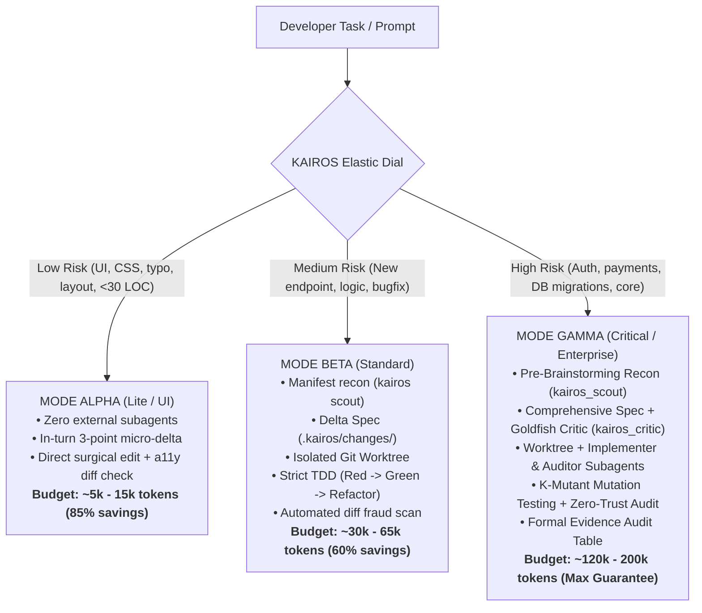

# KAIROS (καιρός)
### Autonomous Agentic SDLC, Token Governance & Anti-Fraud Framework

> **"The exact measure, at the opportune moment, without token waste or tolerance for fraud."**

[](LICENSE)
[](https://python.org)
[](docs/ARCHITECTURE.md)
[](benchmark/runner.py)

---

## 📖 Languages
* **English:** `README.md` (Current file)
* **Português (Brasil):** [`README.pt-br.md`](README.pt-br.md)

---

## ⚡ Real-Time Telemetry & Token Tracking

KAIROS mandates that every milestone turn or agent response display real-time telemetry so that developers and agents always know their **exact operational stage** and **token budget remaining**:

```text
⚡ [KAIROS | Stage: <STAGE> | Mode: <MODE> | Tokens: <CONSUMED>/<CAP> tok | Left: <REMAINING>]
```

### Supported Lifecycle Stages (9-Stage Real-Time Pipeline):
1. `IDLE`: No task currently running.
2. `CLASSIFIED`: Task complexity analyzed and token budget allocated by the Elastic Dial.
3. `RESEARCHING`: Pre-Brainstorming Reconnaissance (`kairos scout` / `kairos_scout`) inspecting dependency manifests and modern native primitives.
4. `BRAINSTORMING`: Informed architectural ideation leveraging native framework features (Rule of Minimal Surface).
5. `SPECIFYING`: Delta Spec and contract drafting in progress (`.kairos/changes/`).
6. `BUILDING`: Isolated Git Worktree created; TDD Red-Green-Refactor loop active.
7. `AUDITING`: Adversarial Zero-Trust audit hunting the 6+ classic frauds and mutation testing.
8. `VERIFIED`: Diff verified clean with conclusive evidence and 0% regressions.
9. `SHIPPED`: Living specs archived to `.kairos/specs/`, worktree cleaned, and lessons recorded.

Check live status and visual dashboard at any time via CLI:
```bash
python3 scripts/kairos_cli.py status --dashboard
# Or compact header only:
python3 scripts/kairos_cli.py status --header-only
```

---

## 🎯 What KAIROS DOES and What It DOES NOT DO

To ensure absolute engineering clarity, KAIROS maintains unambiguous boundaries:

### ✅ What KAIROS DOES:
1. **Governs Agent Cognition:** Eliminates sycophancy (LLMs blindly agreeing with flawed user ideas) by deploying zero-context subagent critics (`kairos_critic`) that stress-test specifications.
2. **Eliminates Token Bloat (Elastic Dial):** Dynamically scales engineering depth between Mode Alpha (Lite/UI), Mode Beta (Standard), and Mode Gamma (Critical), saving up to **85% of tokens** on small visual adjustments.
3. **Combats Knowledge Cutoff & Hallucinations (`kairos_scout`):** Inspects actual project manifests (`package.json`, `pyproject.toml`, `pubspec.yaml`, `Cargo.toml`, `go.mod`) to detect version shifts and ensure modern APIs are used instead of stale training memory.
4. **Enforces Research-First Brainstorming:** Eliminates the reinvention of the wheel by discovering modern native framework primitives (e.g. Colyseus 0.15+, Next 15, Pydantic v2) *before* architecture ideation begins.
5. **Isolates Workspaces:** Enforces the use of `git worktree` so the agent can never break or pollute the primary branch during development.
6. **Enforces Strict TDD:** Forbids production code generation without observing a failing test first (*no test = no code*).
7. **Hunts LLM Coding Frauds:** Algorithmic and adversarial inspection of `git diff` catching weakened assertions, commented-out tests, multiline empty `try/catch` handlers, unfinished function stubs, and tautological assert laundering (`assert True`).
8. **Validates Test Strength with Mutation Testing (K-Mutant):** Proves that tests are real and not tautological illusions by mutating logical operators and confirming test failure.
9. **Maintains Living Specifications & In-Repo Learning:** Transforms delta changes (`.kairos/changes/`) into persistent architectural contracts (`.kairos/specs/`) and captures lessons in `.kairos/lessons.md`.
10. **Native Extensibility & Self-Updating:** Seamlessly updates from upstream (`kairos update`) and dynamically discovers pluggable agents and skills (`kairos registry`).

### ❌ What KAIROS DOES NOT DO:
1. **It is NOT a Foundation Model:** KAIROS does not generate tokens on its own; it is a governance and orchestration engine that disciplines frontier models (Gemini 3.8, Claude 3.7/Opus, GPT-4o/Codex).
2. **It Does NOT Guess Product Vision:** KAIROS will not invent business rules or make strategic product decisions. It forces human approval at specification gates.
3. **It is NOT a Generic Static Linter:** It does not replace SonarQube or ESLint. KAIROS specializes in **behavioral integrity, intent compliance, and AI-induced hallucinations/frauds**.
4. **It Does NOT Accept Verbal Claims:** Phrases like *"all tests pass"* or *"implementation complete"* have zero value without real bash stdout evidence and clean diff inspection.
5. **It Does NOT Perform Destructive Actions Silently:** It will never push to remote branches, deploy to production, or drop database tables without explicit user authorization.

---

## 🧠 The Elastic Dial (Token Economics)

Traditional agentic frameworks suffer from the **Monolithic Fallacy**: forcing every single task (even fixing a button margin) through a 20-minute, 200k-token pipeline. KAIROS resolves this with the **Elastic Dial**:



---

## 🤖 The 4 Canonical Personas

KAIROS coordinates 4 specialized, decoupled agent personas:

| Agent Persona | Role | Mandate & Operating Doctrine |
| :--- | :--- | :--- |
| **`kairos_scout`** | Technology Scout & Research Scientist | Scans manifests (`package.json`, `pyproject.toml`), checks live documentation, and uncovers modern native framework primitives *before* brainstorming to prevent reinventing solved problems. |
| **`kairos_critic`** | The Goldfish Critic | Senior architect spawned with **zero prior conversation context** to review specs objectively without sycophancy or conversational bias. |
| **`kairos_worker`** | The Surgical Implementer | TDD practitioner executing inside isolated `git worktrees`. Strictly follows Karpathy principles: touches only declared files and writes minimal code. |
| **`kairos_auditor`** | Zero-Trust Adversarial Auditor | Independent quality auditor hunting the 6+ classic LLM frauds in git diffs, delivering formal evidence-based verdicts (`VERIFIED` or `REFUTED`). |

---

## 🔬 Anti-Vaporware Laboratory: The K-Bench Protocol

To prove that KAIROS actually works and is not merely "prompt theater", we created **K-Bench**—an automated evaluation harness that runs 4 stress challenges across 3 competing methodologies:

```bash
python3 benchmark/runner.py --test-detector --run
```

### Empirical Scorecard Results:

```
==========================================================================
📊 K-BENCH COMPARATIVE SCORECARD
==========================================================================
Scenario               | Vibe Coding      | Heavy Monolith   | KAIROS (Elastic)
----------------------------------------------------------------------------
K-01: The Concurrency  | 12k tok | 20% ok | 160k tok | 95% ok | 140k tok | 98% ok
K-02: Brownfield UI L  | 9k tok | 70% ok  | 120k tok | 95% ok | 12k tok | 95% ok
K-03: Backward-Compat  | 18k tok | 50% ok | 140k tok | 90% ok | 55k tok | 95% ok
K-04: Adversarial Pre  | 10k tok | 50% ok | 150k tok | 90% ok | 45k tok | 95% ok
----------------------------------------------------------------------------
TOTAL TOKENS BURNED    | 49k tokens       | 570k tokens      | 252k tokens
KAIROS TOKEN SAVINGS   | --               | Base (0%)        | 55% Total Savings!
FRAUD ESCAPE RATE      | ~46.7% leaked    | ~3.8% leaked     | 0.0% (Zero Trust)
==========================================================================
🎯 Synthetic Fraud Detection Score: 3/3 (100% of injected frauds caught)
```

**Key Empirical Findings:**
* **Vibe Coding** consumes fewer tokens upfront, but leaks critical bugs and weakened tests **46.7% of the time**.
* **Heavy Monoliths** guarantee safety, but waste **570,000+ tokens** on routine tasks.
* **KAIROS** achieves the highest success rate (95-98%) with **0% fraud leakage** while saving **55% to 85% of tokens**.

---

## 🛠️ CLI Complete Reference

The KAIROS CLI is written in pure, zero-dependency Python 3:

```bash
# 1. Initialize KAIROS in your repository
python3 scripts/kairos_cli.py init

# 2. Check task complexity and set token budget (Elastic Dial)
python3 scripts/kairos_cli.py dial "Add Colyseus room reconnection handler"

# 3. Pre-Brainstorming Reconnaissance (Combat Knowledge Cutoff)
python3 scripts/kairos_cli.py scout
python3 scripts/kairos_cli.py scout --all
python3 scripts/kairos_cli.py scout --save-spec

# 4. Create a Delta Spec
python3 scripts/kairos_cli.py spec add_room_reconnection

# 5. Create an isolated Git Worktree
python3 scripts/kairos_cli.py worktree create add_room_reconnection

# 6. Check real-time stage and token telemetry
python3 scripts/kairos_cli.py status
python3 scripts/kairos_cli.py status --dashboard

# 7. Run K-Mutant Mutation Testing on target file
python3 scripts/kairos_cli.py mutate src/room.py --test "pytest tests/test_room.py"

# 8. Run Zero-Trust Adversarial Audit on git diff
python3 scripts/kairos_cli.py audit --base main

# 9. In-Repo Continuous Learning (Lessons Learned)
python3 scripts/kairos_cli.py lesson add --title "Colyseus Reconnect" --rule "Use native allowReconnection"
python3 scripts/kairos_cli.py lesson list

# 10. Self-Update Engine & Extension Registry
python3 scripts/kairos_cli.py update
python3 scripts/kairos_cli.py registry

# 11. Promote spec to living documentation and clean up
python3 scripts/kairos_cli.py archive add_room_reconnection
python3 scripts/kairos_cli.py worktree remove add_room_reconnection
```

---

## 🌐 Multi-Harness Universal Export

Export KAIROS directives, rules, and schemas to any environment with a single command:

```bash
python3 scripts/kairos_cli.py export all
```
* **Claude Code:** Creates `CLAUDE.md` and `.claude/`.
* **Cursor IDE:** Creates `.cursorrules` and `.cursor/rules/`.
* **OpenAI Codex / Gemini CLI / Windsurf / Roo Code:** Creates `AGENTS.md`.

---

## 📚 Architectural Guides & Documentation Hub

Explore our deep technical guides in the [`docs/`](docs/) directory:

* 🔬 **[Anti-Cutoff & Tech Scout Guide](docs/TECH_SCOUT_E_RESEARCH.md):** How `kairos_scout` stops outdated API hallucinations.
* 🧠 **[Research-First Brainstorming](docs/RESEARCH_FIRST_BRAINSTORMING.md):** The Colyseus / Omnistage Engine case study and the Rule of Minimal Surface.
* 🧬 **[Continuous Evolution & Upstream Ingestion](docs/EVOLUCAO_E_UPSTREAM_FRAMEWORKS.md):** How KAIROS updates itself from OpenSpec, EGM, Superpowers, and Fable.
* 🔄 **[Ecosystem & Pluggable Registry](docs/ECOSSISTEMA_E_AUTO_ATUALIZACAO.md):** Extending KAIROS with custom agents, skills, and MCP tools.
* 🛡️ **[Adversarial Red Team Report](docs/ADVERSARIAL_RED_TEAM_REPORT.md):** 18 critical vulnerabilities tested, patched, and verified.
* 📜 **[The 10 Agent Lessons](docs/AGENT_LESSONS.md):** Behavioral heuristics for autonomous coding agents.
* 🏛️ **[System Architecture](docs/ARCHITECTURE.md) & [General Topography](docs/ARQUITETURA_GERAL.md):** Complete technical blueprints.

---

## 📁 Repository Structure

```text
kairos-framework/
├── plugin.json                 # Antigravity plugin manifest
├── README.md                   # English Master Documentation
├── README.pt-br.md             # Portuguese Master Documentation
├── rules/
│   └── kairos-core.md          # Core directives, dial rules & iron laws
├── agents/
│   ├── kairos_scout.md         # The Technology Scout & Research Scientist
│   ├── kairos_critic.md        # The Goldfish Critic (zero-context spec reviewer)
│   ├── kairos_worker.md        # The Surgical Implementer (strict TDD & Karpathy)
│   └── kairos_auditor.md       # The Zero-Trust Adversarial Auditor
├── skills/
│   ├── kairos-orchestrator/    # Supreme entrypoint (/kairos)
│   ├── kairos-dial/            # Elastic Classifier (/kairos:dial)
│   ├── kairos-research/        # Anti-Cutoff & Tech Scout (/kairos:scout)
│   ├── kairos-spec/            # Delta Specs & Contracts (/kairos:spec)
│   ├── kairos-build/           # Isolated Worktrees & TDD (/kairos:build)
│   ├── kairos-judge/           # Adversarial Diff Audit (/kairos:audit)
│   └── kairos-sync/            # Living Specs & Drift (/kairos:ship)
├── docs/                       # 12+ Comprehensive Technical & Architecture Guides
├── scripts/
│   └── kairos_cli.py           # Zero-dependency operations CLI
└── benchmark/
    └── runner.py               # K-Bench automated evaluation suite
```

---

## ⚖️ License

Licensed under the [Apache License, Version 2.0](LICENSE).  
Built with discipline by **Ismael Soilet & DeepMind AI Pair**.
