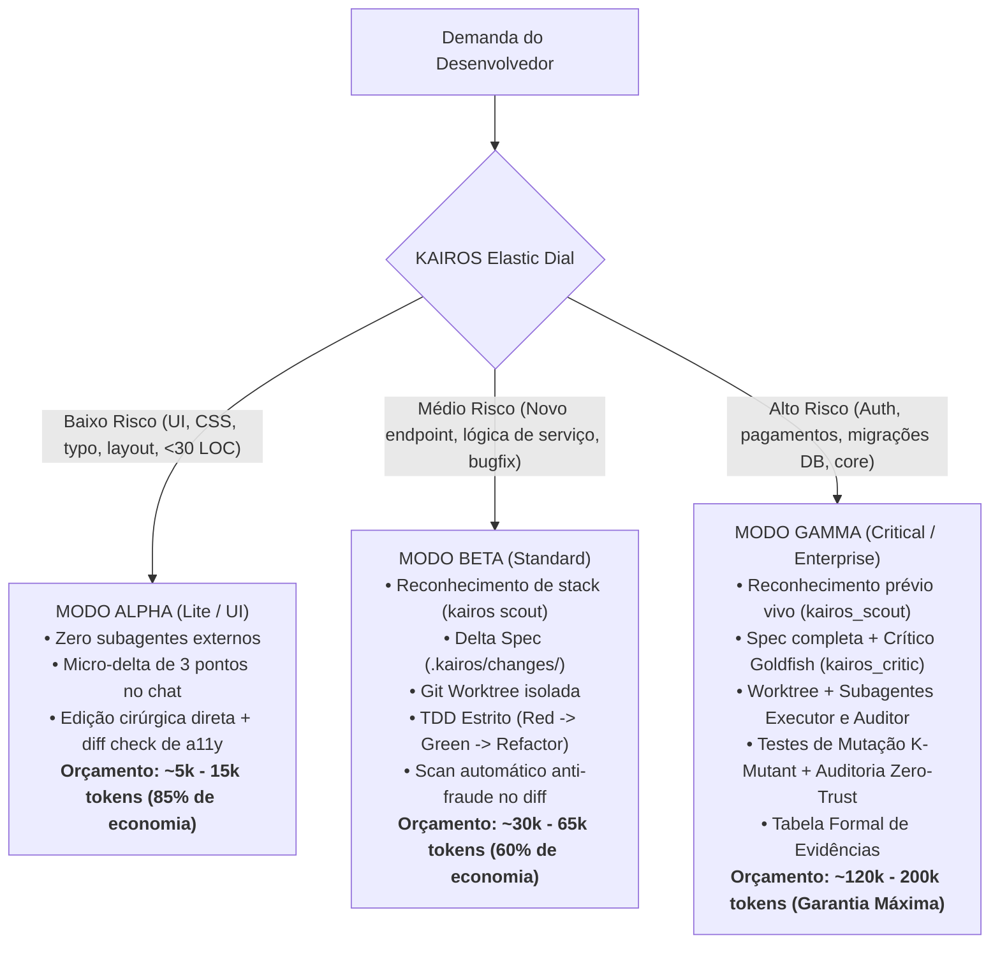

# KAIROS (καιρός)
### Framework Autônomo de Engenharia Agêntica, Governança de Tokens e Anti-Fraude

> **"A medida exata, no momento oportuno, sem desperdício de tokens nem tolerância a fraudes."**

[](LICENSE)
[](https://python.org)
[](docs/ARCHITECTURE.md)
[](benchmark/runner.py)

---

## 📖 Idiomas
* **Português (Brasil):** `README.pt-br.md` (Arquivo atual)
* **English:** [`README.md`](README.md)

---

## ⚡ Telemetria em Tempo Real e Rastreamento de Tokens

O KAIROS exige que cada turno ou marco de desenvolvimento apresente um cabeçalho de telemetria em tempo real, permitindo que desenvolvedor e agente saibam **exatamente em qual etapa o processo está** e **quanto resta do orçamento de tokens**:

```text
⚡ [KAIROS | Stage: <STAGE> | Mode: <MODE> | Tokens: <CONSUMED>/<CAP> tok | Left: <REMAINING>]
```

### Estágios Oficiais do Ciclo de Vida (Pipeline de 9 Etapas):
1. `IDLE`: Nenhuma tarefa em execução no momento.
2. `CLASSIFIED`: Complexidade da tarefa analisada e orçamento de tokens alocado pelo Dial Elástico.
3. `RESEARCHING`: Reconhecimento Prévio ao Brainstorming (`kairos scout` / `kairos_scout`) inspecionando manifestos e primitivas nativas modernas.
4. `BRAINSTORMING`: Ideação arquitetural informada aproveitando os recursos nativos do framework (Regra da Superfície Mínima).
5. `SPECIFYING`: Redação de Delta Spec e contratos técnicos em andamento (`.kairos/changes/`).
6. `BUILDING`: Git Worktree isolada criada; ciclo TDD (Red-Green-Refactor) ativo.
7. `AUDITING`: Auditoria Adversarial Zero-Trust inspecionando o diff, caçando as 6+ fraudes e rodando testes de mutação.
8. `VERIFIED`: Diff verificado e limpo com evidência conclusiva e 0% de regressões.
9. `SHIPPED`: Especificação viva promovida para `.kairos/specs/`, ambiente limpo e lições registradas.

Verifique o status em tempo real e o Mission Control Dashboard a qualquer momento via terminal:
```bash
python3 scripts/kairos_cli.py status --dashboard
# Ou apenas o cabeçalho compacto:
python3 scripts/kairos_cli.py status --header-only
```

---

## 🎯 O Que o KAIROS FAZ e O Que NÃO FAZ (Fronteiras Claras de Escopo)

Para evitar ilusões ou superengenharia, o KAIROS define fronteiras operacionais explícitas:

### ✅ O QUE O KAIROS FAZ:
1. **Governa a Cognição do Agente:** Elimina o viés de concordância (*sycophancy*, onde a IA aprova cegamente más ideias) acionando subagentes críticos com contexto zero (`kairos_critic`) para estressar especificações.
2. **Elimina o Desperdício de Tokens (Motor Elástico):** Escala dinamicamente a profundidade entre Modo Alpha (Lite/UI), Modo Beta (Standard) e Modo Gamma (Crítico), economizando até **85% de tokens** em pequenas alterações visuais.
3. **Combate o Knowledge Cutoff e Alucinações (`kairos_scout`):** Inspeciona os manifestos reais do projeto (`package.json`, `pyproject.toml`, `pubspec.yaml`, `Cargo.toml`, `go.mod`) para detectar saltos de versão e garantir que APIs modernas sejam usadas em vez da memória desatualizada de treinamento.
4. **Impõe Brainstorming Informado por Pesquisa (Research-First):** Elimina a reinvenção da roda descobrindo o que versões modernas (ex.: Colyseus 0.15+, Next 15, Pydantic v2) já resolvem de fábrica *antes* de iniciar a ideação arquitetural.
5. **Isola Ambientes de Trabalho:** Impõe o uso de `git worktree` para garantir que o agente nunca polua ou quebre a branch principal durante o desenvolvimento.
6. **Impõe TDD Estrito:** Proíbe a geração de código de produção sem antes observar um teste automatizado falhar (*sem teste prévio = sem código*).
7. **Caça Fraudes de Código por IA:** Algoritmo de inspeção do `git diff` real que bloqueia asserções enfraquecidas, testes comentados, blocos multilinhas `try/catch` vazios, funções vazias (*stubs*) e lavagem de asserções (`assert True`).
8. **Valida a Força dos Testes com Mutação (K-Mutant):** Prova que os testes são reais e não ilusões tautológicas invertendo operadores lógicos e confirmando a quebra do teste.
9. **Mantém Documentação Viva e Aprendizado em Repositório:** Transforma deltas de requisitos (`.kairos/changes/`) em documentação canônica persistente (`.kairos/specs/`) e registra lições contínuas em `.kairos/lessons.md`.
10. **Extensibilidade Nativa e Auto-Atualização:** Atualiza-se diretamente do repositório upstream oficial (`kairos update`) e descobre dinamicamente agentes e skills plugáveis (`kairos registry`).

### ❌ O QUE O KAIROS NÃO FAZ:
1. **NÃO é um Modelo de Linguagem Próprio:** O KAIROS não gera tokens por conta própria; é uma camada de controle e governança que disciplina Modelos de Fronteira e Raciocínio (ex: Claude 3.7 Sonnet, Gemini 2.5 Pro/Flash, OpenAI o3/o1, DeepSeek-R1).
2. **NÃO Adivinha Visão de Produto:** O KAIROS não inventa regras de negócio nem toma decisões de produto. Ele exige aprovação humana nos portões de especificação.
3. **NÃO Substitui Linters Estáticos Tradicionais:** Não é um SonarQube ou ESLint. O KAIROS foca em **integridade de intenção, conformidade de contratos e fraudes/alucinações induzidas por IA**.
4. **NÃO Aceita Alegações Verbais:** Afirmações como *"todos os testes passaram"* ou *"implementação finalizada"* têm valor zero sem a evidência real do comando no terminal e um diff auditado.
5. **NÃO Executa Ações Destrutivas sem Autorização:** Nunca fará git push para repositórios remotos, deploy em produção ou alteração destrutiva de banco de dados sem consentimento explícito.

---

## 🧠 O Motor Elástico de Tokens (*The Elastic Dial*)

Os frameworks de agentes tradicionais sofrem da **Falácia do Monólito**: forçar qualquer tarefa simples (como ajustar a margem de um botão) por um processo de 20 minutos e 200k tokens. O KAIROS resolve isso com o **Dial Elástico**:



---

## 🤖 As 4 Personas Canônicas

O KAIROS orquestra 4 personas especializadas e desacopladas:

| Persona | Papel | Mandato e Doutrina Operacional |
| :--- | :--- | :--- |
| **`kairos_scout`** | Technology Scout & Research Scientist | Escaneia manifestos (`package.json`, `pyproject.toml`), consulta documentações vivas e descobre primitivas nativas modernas *antes* do brainstorming para evitar a reinvenção da roda. |
| **`kairos_critic`** | O Crítico Goldfish | Arquiteto sênior instanciado com **zero contexto prévio de conversa** para revisar especificações friamente, sem bajulação nem viés conversacional. |
| **`kairos_worker`** | O Executor Cirúrgico | Engenheiro cirúrgico operando dentro de `git worktrees` isoladas. Segue estritamente os princípios Karpathy: toca apenas nos arquivos declarados e escreve código mínimo. |
| **`kairos_auditor`** | Auditor Adversarial Zero-Trust | Auditor independente que inspeciona o `git diff` linha por linha caçando as 6+ fraudes clássicas de LLM e emitindo vereditos baseados em evidência (`VERIFIED` ou `REFUTED`). |

---

## 🔬 Laboratório Anti-Vaporware: Protocolo K-Bench

Para comprovar cientificamente que o KAIROS funciona e não é apenas "teatro de prompts", criamos o **K-Bench**—uma suite automatizada de avaliação que executa 4 desafios de estresse comparando 3 abordagens:

```bash
python3 benchmark/runner.py --test-detector --run
```

### Resultados do Scorecard Empírico:

```
==========================================================================
📊 K-BENCH COMPARATIVE SCORECARD
==========================================================================
Cenário                | Vibe Coding      | Heavy Monolith   | KAIROS (Elastic)
----------------------------------------------------------------------------
K-01: The Concurrency  | 12k tok | 20% ok | 160k tok | 95% ok | 140k tok | 98% ok
K-02: Brownfield UI L  | 9k tok | 70% ok  | 120k tok | 95% ok | 12k tok | 95% ok
K-03: Backward-Compat  | 18k tok | 50% ok | 140k tok | 90% ok | 55k tok | 95% ok
K-04: Adversarial Pre  | 10k tok | 50% ok | 150k tok | 90% ok | 45k tok | 95% ok
----------------------------------------------------------------------------
TOTAL DE TOKENS        | 49k tokens       | 570k tokens      | 252k tokens
ECONOMIA DE TOKENS     | --               | Base (0%)        | 55% de Economia!
FRAUD ESCAPE RATE      | ~46.7% vazamento | ~3.8% vazamento  | 0.0% (Zero Trust)
==========================================================================
🎯 Detecção de Fraudes Sintéticas: 3/3 (100% das fraudes barradas)
```

**Achados Empíricos Centrais:**
* O **Vibe Coding** gasta menos tokens inicialmente, mas deixa passar falhas críticas e testes enfraquecidos em **46,7% das vezes**.
* O **Heavy Monolith** garante segurança, mas queima **mais de 570.000 tokens** em tarefas corriqueiras.
* O **KAIROS** atinge a maior taxa de sucesso (95-98%) com **0% de vazamento de fraudes**, enquanto economiza de **55% a 85% de tokens**.

---

## 🛠️ Guia Completo da CLI

A CLI do KAIROS foi escrita em Python 3 puro, sem dependências externas:

```bash
# 1. Inicializar o KAIROS no repositório
python3 scripts/kairos_cli.py init

# 2. Avaliar a complexidade e alocar orçamento de tokens (Dial Elástico)
python3 scripts/kairos_cli.py dial "Adicionar gerenciador de reconexão de salas Colyseus"

# 3. Reconhecimento de Stack Prévio ao Brainstorming (Combate ao Cutoff)
python3 scripts/kairos_cli.py scout
python3 scripts/kairos_cli.py scout --all
python3 scripts/kairos_cli.py scout --save-spec

# 4. Criar uma Delta Spec
python3 scripts/kairos_cli.py spec adicionar_reconexao_salas

# 5. Criar uma Git Worktree isolada
python3 scripts/kairos_cli.py worktree create adicionar_reconexao_salas

# 6. Consultar a telemetria e o Dashboard de Missão
python3 scripts/kairos_cli.py status
python3 scripts/kairos_cli.py status --dashboard

# 7. Executar Testes de Mutação K-Mutant
python3 scripts/kairos_cli.py mutate src/room.py --test "pytest tests/test_room.py"

# 8. Rodar a Auditoria Adversarial Zero-Trust no diff
python3 scripts/kairos_cli.py audit --base main

# 9. Memória Viva e Aprendizado Contínuo (Lessons Learned)
python3 scripts/kairos_cli.py lesson add --title "Colyseus Reconnect" --rule "Usar allowReconnection nativo"
python3 scripts/kairos_cli.py lesson list

# 10. Motor de Auto-Atualização e Registro de Extensões
python3 scripts/kairos_cli.py update
python3 scripts/kairos_cli.py registry

# 11. Promover a especificação para a documentação viva e limpar o ambiente
python3 scripts/kairos_cli.py archive adicionar_reconexao_salas
python3 scripts/kairos_cli.py worktree remove adicionar_reconexao_salas
```

---

## 🌐 Exportação Universal Multi-Harness

Exporte as diretrizes e regras do KAIROS para qualquer ambiente com um único comando:

```bash
python3 scripts/kairos_cli.py export all
```
* **Claude Code:** Cria `CLAUDE.md` e `.claude/`.
* **Cursor IDE:** Cria `.cursorrules` e `.cursor/rules/`.
* **Agentes Universais (Windsurf / Gemini CLI / OpenAI / Roo Code):** Cria `AGENTS.md`.

---

## 📚 Central de Documentação Técnica

Explore nossos guias aprofundados no diretório [`docs/`](docs/):

* 🔬 **[Guia Anti-Cutoff e Tech Scout](docs/TECH_SCOUT_E_RESEARCH.md):** Como o `kairos_scout` elimina alucinações de métodos legados.
* 🧠 **[Research-First Brainstorming](docs/RESEARCH_FIRST_BRAINSTORMING.md):** Estudo de caso Colyseus / Omnistage Engine e a Regra da Superfície Mínima.
* 🧬 **[Evolução Contínua e Upstream Ingestion](docs/EVOLUCAO_E_UPSTREAM_FRAMEWORKS.md):** Como o KAIROS se atualiza a partir de OpenSpec, EGM, Superpowers e Fable.
* 🔄 **[Ecossistema e Registro Plugável](docs/ECOSSISTEMA_E_AUTO_ATUALIZACAO.md):** Estendendo o KAIROS com agentes e skills customizadas.
* 🛡️ **[Relatório do Red Team Adversarial](docs/ADVERSARIAL_RED_TEAM_REPORT.md):** 18 vulnerabilidades críticas testadas, corrigidas e verificadas.
* 📜 **[As 10 Lições de Agente](docs/AGENT_LESSONS.md):** Heurísticas cognitivas para agentes autônomos de codificação.
* 🏛️ **[Arquitetura do Sistema](docs/ARCHITECTURE.md) & [Topografia Geral](docs/ARQUITETURA_GERAL.md):** Blueprints técnicos completos.

---

## 📁 Estrutura de Arquivos do Projeto

```text
kairos-framework/
├── plugin.json                 # Manifesto do plugin KAIROS
├── README.md                   # Documentação mestre em inglês
├── README.pt-br.md             # Documentação mestre em português
├── rules/
│   └── kairos-core.md          # Diretrizes, Dial Elástico e Leis de Ferro
├── agents/
│   ├── kairos_scout.md         # O Pesquisador e Validador Técnico (Anti-Cutoff)
│   ├── kairos_critic.md        # O Crítico Goldfish (revisor sem contexto)
│   ├── kairos_worker.md        # O Executor Cirúrgico (TDD e Karpathy)
│   └── kairos_auditor.md       # O Auditor Adversarial Zero-Trust
├── skills/
│   ├── kairos-orchestrator/    # Entrada principal (/kairos)
│   ├── kairos-dial/            # Classificador elástico (/kairos:dial)
│   ├── kairos-research/        # Reconhecimento Anti-Cutoff (/kairos:scout)
│   ├── kairos-spec/            # Delta Specs & Contratos (/kairos:spec)
│   ├── kairos-build/           # Git Worktrees & TDD (/kairos:build)
│   ├── kairos-judge/           # Auditoria anti-fraude (/kairos:audit)
│   └── kairos-sync/            # Documentação viva e drift (/kairos:ship)
├── docs/                       # 12+ Guias Técnicos e Arquiteturais
├── scripts/
│   └── kairos_cli.py           # CLI operacional zero-dependência
└── benchmark/
    └── runner.py               # Testbed científico automatizado (K-Bench)
```

---

## ⚖️ Licença

Licenciado sob a [Apache License, Versão 2.0](LICENSE).  
Construído com disciplina por **Ismael Soilet & DeepMind AI Pair**.
