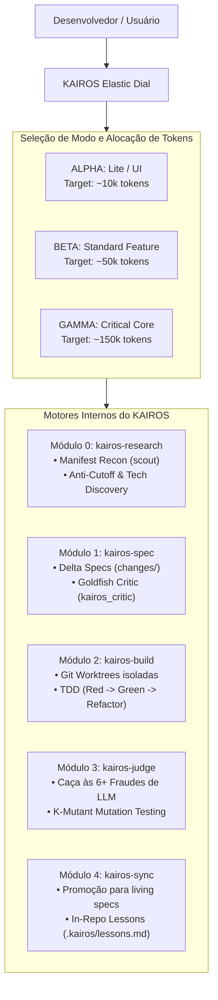

# KAIROS Architecture & Specification Guide

Este documento detalha o funcionamento interno dos motores, personas e subsistemas de governança do **KAIROS**.

---

## 1. O Triângulo de Confiança e o Dial Elástico

O KAIROS opera como uma camada de controle cognitivo (*Cognitive Control Plane*) que se interpõe entre a intenção do desenvolvedor e as ferramentas de sistema (bash, edit, git, runners de teste).

---

## 2. As 4 Personas Especializadas

O KAIROS dissocia a cognição do agente em 4 agentes especializados, evitando que o mesmo modelo assuma papéis conflitantes:

1. **`kairos_scout` (Technology Scout & Research Scientist):**
   - Executa antes do brainstorming. Inspeciona manifestos locais (`package.json`, `pyproject.toml`) e documentações vivas.
   - Identifica primitivas nativas do framework para evitar que o time reinvente a roda com código customizado desnecessário.
2. **`kairos_critic` (The Goldfish Critic):**
   - Instanciado no Modo Gamma com **zero contexto prévio** para revisar especificações friamente, eliminando o viés de concordância (*sycophancy*).
3. **`kairos_worker` (The Surgical Implementer):**
   - Atua exclusivamente em `git worktrees` isoladas, seguindo TDD estrito e respeitando o raio de impacto (*blast radius*).
4. **`kairos_auditor` (Zero-Trust Adversarial Auditor):**
   - Avalia o `git diff` linha por linha procurando por fraudes de código e atesta a validade dos testes via testes de mutação.

---

## 3. O Fluxo de 9 Estágios em Tempo Real

A máquina de estados do KAIROS rastreia o ciclo de desenvolvimento em 9 fases rastreáveis no dashboard:

$$\text{IDLE} \rightarrow \text{CLASSIFIED} \rightarrow \text{RESEARCHING} \rightarrow \text{BRAINSTORMING} \rightarrow \text{SPECIFYING} \rightarrow \text{BUILDING} \rightarrow \text{AUDITING} \rightarrow \text{VERIFIED} \rightarrow \text{SHIPPED}$$

---

## 4. O Algoritmo de Caça às 6+ Fraudes de LLM (`kairos_auditor`)

O motor de auditoria analisa o `git diff` linha por linha, procurando ativamente por:

1. **Testes Enfraquecidos / Deletados:**
   - Detecção de comentários `# assert`, `// expect`.
   - Detecção de supressões seletivas: `.only`, `.skip()`, `xit`, `@pytest.mark.skip`, `@pytest.mark.xfail`.
   - Detecção de remoção de arquivos de teste (`+++ /dev/null`).
2. **Lavagem de Asserções (Tautological Assertions):**
   - Substituição de testes reais por asserções que sempre passam (`assert True`, `assert 1 == 1`).
3. **Falhas Silenciosas (Empty Catches):**
   - Blocos `try/except: pass`, `except Exception: pass`, e `catch (e) {}` vazios de múltiplas linhas adicionados no código novo.
4. **Stubs e Conclusões Fantasmas:**
   - Funções adicionadas contendo apenas `pass`, `...`, `return None` ou `return {}` sem lógica real.
5. **Violações de Escopo (Blast Radius):**
   - Alterações em arquivos fora da lista declarada em `tasks.md`.
6. **Mutações K-Mutant:**
   - Mutação automática de operadores lógicos (`==` para `!=`, `True` para `False`, `>` para `<=`) para verificar se os testes realmente quebram.

---

## 5. Especificação Viva e Aprendizado Contínuo

Ao finalizar uma tarefa com o comando `kairos archive`:
1. A especificação delta em `.kairos/changes/<id>/specs.md` é promovida para `.kairos/specs/<feature>.md`.
2. O histórico de lições aprendidas e diretivas preventivas é persistido em `.kairos/lessons.md` via `kairos lesson add`.
3. A `git worktree` temporária é excluída, deixando o repositório em estado limpo e pronto para o merge final.
