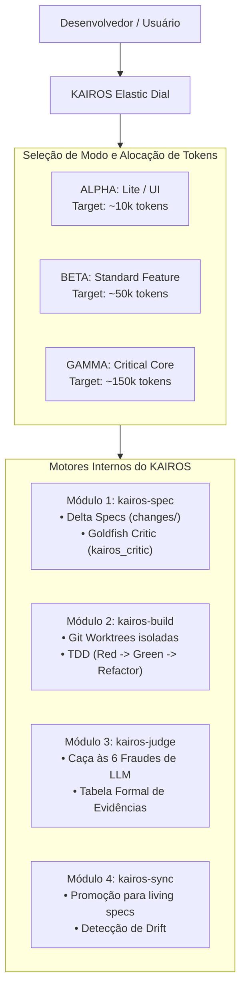

# KAIROS Architecture & Specification Guide

Este documento detalha o funcionamento interno dos motores e subagentes do KAIROS.

---

## 1. O Triângulo de Confiança e o Dial Elástico

O KAIROS opera como uma camada de controle cognitivo (*Cognitive Control Plane*) que se interpõe entre a intenção do desenvolvedor e as ferramentas de sistema (bash, edit, git, runners de teste).

---

## 2. A Mecânica do Goldfish Nativo (`kairos_critic`)

O maior risco em sessões longas de IA é o **viés de concordância (*sycophancy*)**. O agente principal tende a aprovar suas próprias ideias ou as do usuário sem examinar riscos de borda.

* **Como o KAIROS resolve:** No Modo Gamma, o KAIROS dispara o subagente `kairos_critic`.
* **Isolamento de Contexto:** O `kairos_critic` recebe apenas:
  1. O arquivo `specs.md` e `proposal.md` recém-criados.
  2. A lista de arquivos de código relevantes.
* Ele **não** recebe a conversa do chat que gerou a ideia. Ele lê a especificação friamente como um arquiteto sênior que acabou de entrar no projeto.

---

## 3. O Algoritmo de Caça às 6 Fraudes (`kairos_auditor`)

O motor de auditoria analisa o `git diff` linha por linha, procurando por:

1. **Testes Enfraquecidos / Deletados:**
   * Detecção de comentários `# assert`, `// expect`.
   * Detecção de anotações `.skip()`, `xit`, `@pytest.mark.skip`.
2. **Falhas Silenciosas:**
   * Blocos `except: pass`, `except Exception: pass`, `catch (e) {}` vazios adicionados no código novo.
3. **Stubs e Conclusões Fantasmas:**
   * Funções adicionadas contendo apenas `pass`, `...` ou `throw new NotImplementedError`.
4. **Violações de Escopo (Blast Radius):**
   * Alterações em arquivos fora da lista declarada em `tasks.md`.

---

## 4. O Sistema de Especificação Viva

Ao finalizar uma tarefa com o comando `/kairos:ship`:
1. O KAIROS promove a especificação delta de `.kairos/changes/<id>/specs.md` para a pasta canônica `.kairos/specs/<feature>.md`.
2. O histórico de mudanças é gravado em `.kairos/state.json`.
3. A `git worktree` temporária é excluída, deixando o repositório em estado limpo e pronto para o merge final.
