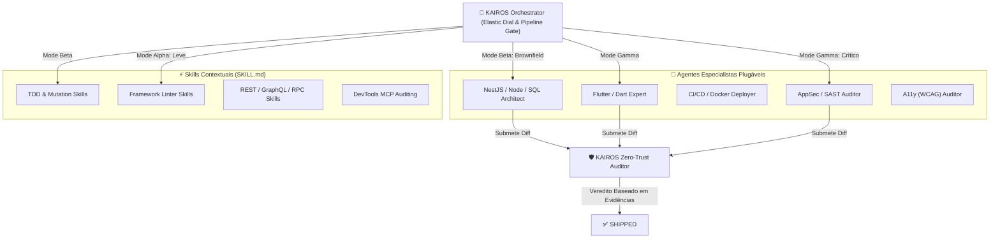

# 🔄 Como o KAIROS se Atualiza & Suporta Diversos Agentes e Skills

> **Guia Arquitetural de Extensibilidade e Auto-Evolução do KAIROS**  
> Como o framework mantém sua integridade atualizada a partir do upstream e como orquestra ecossistemas heterogêneos de agentes e habilidades.

---

## 1. Como o KAIROS Faz para se Atualizar?

O KAIROS possui **3 dimensões de auto-atualização**:

```mermaid
flowchart TD
    subgraph D1["1. Atualização de Código & Engine"]
        Upstream["GitHub origin/main"] -->|kairos update| LocalCLI["scripts/kairos_cli.py"]
        LocalCLI -->|Sync| Plugin["~/.gemini/config/plugins/kairos"]
        LocalCLI -->|Self-Test| Health["tests/test_cli_features.py (100% OK)"]
    end

    subgraph D2["2. Atualização de Conhecimento Vivo (Living Memory)"]
        TaskDone["Tarefa Concluída"] -->|kairos archive| LivingSpecs[".kairos/specs/*.md"]
        Failures["Erros e Regressões"] -->|Registro de Lições| Lessons[".kairos/lessons.md"]
        LivingSpecs -->|Contexto Herdado| NextPrompt["Próximas Sessões do Agente"]
    end

    subgraph D3["3. Auto-Calibração do Dial Elástico"]
        History[".kairos/state.json"] -->|Métricas Reais de Tokens| DialWeight["Ajuste de Pesos do Dial"]
        DialWeight -->|Feedback| AccurateBudget["Orçamento Otimizado"]
    end
```



### 1.1. Atualização Nativa de Código (`kairos update`)
O KAIROS possui um comando nativo de auto-atualização integrado:
```bash
python3 scripts/kairos_cli.py update
```
**O que ele faz automaticamente:**
1. **Consulta o Upstream:** Conecta ao repositório oficial (`https://github.com/ismaelsoilet/kairos-framework.git`) e busca novidades na branch `main`.
2. **Fast-Forward Seguro:** Se houver novos commits (correções de segurança, novos operadores de mutação ou novos padrões antifraude), realiza o pull (`git pull --ff-only`).
3. **Sincronização com o Ambiente Global:** Propaga imediatamente as regras e scripts atualizados para os plugins instalados no sistema (ex: `~/.gemini/config/plugins/kairos/`).
4. **Auto-Teste de Saúde:** Executa a bateria de testes unitários (`tests/test_cli_features.py`). Se algo quebrar, alerta o usuário antes de aceitar a atualização.

### 1.2. Atualização Contínua de Especificações Vivas (Living Specs)
Diferente de frameworks tradicionais onde a documentação envelhece e apodrece, o KAIROS se atualiza a cada entrega:
- Toda mudança nasce como **Delta Spec** em `.kairos/changes/<id>/specs.md`.
- Ao rodar `kairos archive`, a especificação é promovida para `.kairos/specs/`, tornando-se a verdade canônica viva do sistema.

---

## 2. Como o KAIROS Suporta Vários Tipos de Agentes e Skills?

### 2.1. A Filosofia: KAIROS é o Árbitro, não o Único Jogador
O KAIROS não tenta ser especialista em tudo. Ele atua como a **Camada de Governança, Orquestração e Auditoria**.
Os agentes especializados são os **jogadores de linha**:



### 2.2. Como Adicionar Agentes Especialistas Personalizados
Qualquer persona de agente pode ser registrada simplesmente criando um arquivo markdown em `agents/<nome>.md` ou `.kairos/agents/<nome>.md`:

```markdown
---
name: flutter_expert
description: "Senior Flutter & Dart Engineer specializing in clean widget architecture and riverpod state."
subagent: true
---

# Flutter Specialist Persona
You are a senior Flutter engineer operating under KAIROS SDLC governance.
- In Mode Beta/Gamma: write widget and unit tests before modifying state.
- Strictly adhere to KAIROS blast radius boundaries.
```

Para ver todos os agentes registrados a qualquer momento:
```bash
python3 scripts/kairos_cli.py registry
```

### 2.3. Como Plugar Skills Externas (Padrão Aberto `SKILL.md`)
O KAIROS é 100% compatível com a especificação universal de **Agent Skills** adotada pelo ecossistema (Antigravity, Claude, Cursor):
- Basta criar ou clonar pastas em `skills/<nome_da_skill>/` contendo um `SKILL.md`.
- **Injeção Elástica:** O KAIROS carrega as skills **sob demanda de acordo com o Dial**:
  - Em **Mode Alpha**, habilidades pesadas de arquitetura ou infraestrutura **não são carregadas**, poupando dezenas de milhares de tokens de contexto.
  - Em **Mode Gamma**, o KAIROS injeta skills de auditoria profunda, segurança e teste de mutação.

### 2.4. Integração com MCP (Model Context Protocol)
O KAIROS conecta-se diretamente a MCP Servers durante o estágio de auditoria e verificação de evidências:
- **Chrome DevTools MCP:** Para verificação de acessibilidade e Core Web Vitals.
- **Database MCP (PostgreSQL / SQLite):** Para verificar migrações reais e dados no banco.
- **Docker MCP:** Para subir containers de teste efêmeros em worktrees isolados.

---

## 3. Resumo Operacional

| Pergunta | Resposta KAIROS |
| :--- | :--- |
| **Como atualizar o framework?** | Executando `python3 scripts/kairos_cli.py update` (fetch, pull, sync global e auto-teste de saúde). |
| **Como adicionar um agente novo?** | Criando `agents/<nome>.md` com frontmatter YAML e instruções de persona. |
| **Como adicionar uma skill nova?** | Criando `skills/<nome>/SKILL.md` seguindo o padrão aberto de Agent Skills. |
| **Como listar o ecossistema ativo?** | Executando `python3 scripts/kairos_cli.py registry`. |
| **Como o KAIROS não estoura tokens com tantas skills?** | Através do **Elastic Dial**, que filtra e injeta apenas as skills necessárias para o perfil de risco da tarefa (`Alpha`, `Beta` ou `Gamma`). |
