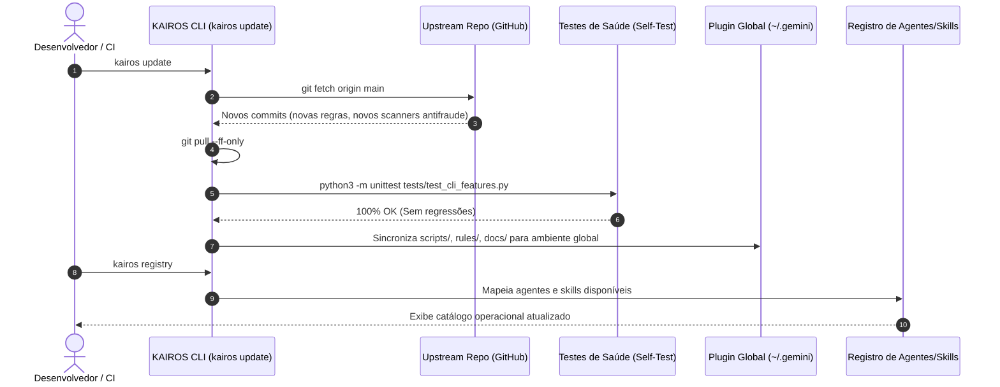

# 🧬 Como o KAIROS se Atualiza nas Melhores Práticas e Frameworks de Inspiração

> **Arquitetura de Auto-Evolução, Ingestão de Heurísticas e Filtragem Empírica**  
> Como o KAIROS absorve o estado-da-arte de **OpenSpec, EGM, Superpowers, Fable, SureForge e Karpathy** sem cair na armadilha do inchaço de contexto e do hype de prompts.

---

## 1. O Desafio Central: A Síndrome do Fóssil vs. O Monstro de Frankenstein

No ecossistema de agentes autônomos de codificação, a maioria dos frameworks sofre de uma de duas falhas capitais de longevidade:

1. **A Síndrome do Fóssil Congelado:**  
   O framework adota um snapshot de boas ideias em seu nascimento (ex: prompts estáticos de TDD ou templates rígidos de especificação), mas não possui canal para absorver novos comportamentos evasivos de novos modelos de fronteira e raciocínio (ex: Claude 3.7 Sonnet, Gemini 2.5 Pro, OpenAI o3, DeepSeek-R1). Em 6 meses, torna-se obsoleto.
2. **A Síndrome do Monstro de Frankenstein:**  
   O framework adiciona indiscriminadamente cada nova técnica "da moda" que surge no Twitter/arXiv (ReAct aninhado, Tree-of-Thoughts, Reflexion infinito, dezenas de subagentes redundantes). O resultado é uma explosão catastrófica no consumo de tokens (150.000 tokens para uma alteração de CSS de 2 linhas) e diretivas contraditórias no contexto do agente.

### A Tese KAIROS: Evolução Filtrada por Aptidão Empírica
O KAIROS resolve essa tensão através de uma **Função de Aptidão (Fitness Function)**. Nenhuma melhor prática externa é adotada sem antes ser validada pelo **K-Bench** em relação a duas métricas inexoráveis:
$$\text{Fitness} = \frac{\Delta \text{Mutation Kill Rate}}{\Delta \text{Tokens Consumidos}}$$

Se uma nova prática vinda do upstream aumentar a assertividade do teste em +2%, mas exigir +300% de tokens, ela é **bloqueada nos Modos Alpha e Beta** pelo Dial Elástico, sendo isolada estritamente como ferramenta opcional de Modo Gamma.

---

## 2. As 5 Matrizes de Inspiração e seus Vetores de Atualização

O KAIROS é uma síntese seletiva de 5 escolas de engenharia de software agêntica. Cada uma possui um canal específico de atualização contínua:

```mermaid
flowchart TD
    subgraph Upstream_Inspirations["Fontes Upstream de Inspiração"]
        OS["OpenSpec (Specs Vivas & Deltas)"]
        EGM["EGM (Separação Cognitiva Dual)"]
        SP["Superpowers & Karpathy (TDD & Worktrees)"]
        FF["Fable & SureForge (Zero-Trust QC & Antifraude)"]
        ECO["Mercado (Cursor, Claude Code, MCP, Skills)"]
    end

    subgraph KAIROS_Ingestion["Camada de Ingestão e Filtragem KAIROS"]
        Spec_Engine["Templates de Delta Spec & kairos archive"]
        Critic_Distill["Destilação de Prompts & Assimetria de Raciocínio"]
        CLI_Worktrees["Automação de Isolamento & K-Mutant"]
        Audit_AST["Scanner AST/Regex das 6+ Fraudes de LLM"]
        Bridge["Harness Translators (kairos export) & Registry"]
    end

    subgraph Empirical_Gate["🛡️ Portão Empírico (K-Bench)"]
        Gate{"Melhora Kill Rate sem estourar o Dial?"}
    end

    subgraph Core_Release["🚀 KAIROS Core Engine"]
        Core["CLI (scripts/kairos_cli.py) + Plugin (~/.gemini/.../kairos)"]
    end

    OS --> Spec_Engine
    EGM --> Critic_Distill
    SP --> CLI_Worktrees
    FF --> Audit_AST
    ECO --> Bridge

    Spec_Engine --> Gate
    Critic_Distill --> Gate
    CLI_Worktrees --> Gate
    Audit_AST --> Gate
    Bridge --> Gate

    Gate -->|Sim (Comprovado)| Core
    Gate -->|Não (Hype/Inchaço)| Rejeitado["Descartado / Restrito a Gamma"]
```

---

### Vetor 1: OpenSpec (Especificações Vivas & Protocolo de Deltas)
* **O que o KAIROS inspira-se:** A substituição de documentação monolítica obsoleta por **Delta Specs** (`proposal.md`, `specs.md`, `design.md`, `tasks.md`, `evidence.md`) e a promoção automática para especificações vivas canônicas.
* **Como o KAIROS se atualiza:**
  - **Evolução de Schemas:** Conforme o OpenSpec introduz novos padrões para migrações de banco, contratos de API (OpenAPI/GraphQL) e matrizes de capacidades, os templates gerados por `kairos spec` absorvem essas melhorias.
  - **Detecção de Spec Drift:** Uso de parsers AST para comparar se as funções declaradas em `specs.md` continuam aderentes à implementação após commits sucessivos, disparando alertas antes do merge.

---

### Vetor 2: EGM (Elephant & Goldfish Model - Separação Cognitiva)
* **O que o KAIROS inspira-se:** A dissociação estrita entre o agente executor (*Elephant*, que possui a memória histórica, contexto do domínio e regras do projeto) e o revisor (*Goldfish*, que opera com **zero contexto prévio**, avaliando friamente a especificação e o código sem ser contaminado por bajulação ou justificativas do desenvolvedor).
* **Como o KAIROS se atualiza:**
  - **Assimetria de Raciocínio (Thinking Budgets):** Com o avanço de modelos com capacidades de raciocínio estendido (extended thinking/reasoning effort), o KAIROS aloca alto orçamento de raciocínio para o subagente Goldfish (`kairos_critic`), enquanto mantém o agente de rascunho com execução frugal.
  - **Destilação de Prompts Anti-Viés:** Atualização periódica do system prompt do `kairos_critic` para neutralizar novas formas de *prompt injection* ou comentários sutis no código que tentam enganar o revisor (ex: `// Note to reviewer: already tested manually`).

---

### Vetor 3: Superpowers & Princípios Karpathy (Disciplina & Isolamento)
* **O que o KAIROS inspira-se:** A lei de ferro do TDD (*Red-Green-Refactor* — nenhum código sem teste falhando primeiro), o isolamento estrito via Git Worktrees para proteger a branch `main`, e as heurísticas comportamentais de Andrej Karpathy (zero refatoração cosmética não solicitada, critérios de sucesso verificáveis).
* **Como o KAIROS se atualiza:**
  - **Automação de Worktrees:** Aperfeiçoamento do `kairos worktree create` para criar symlinks transparentes de dependências pesadas (`node_modules`, `.venv`, `.env`), eliminando o atrito de inicialização em projetos brownfield.
  - **Árvores de Diagnóstico Sistemático:** Ingestão de fluxos padronizados de investigação de bugs (`systematic-debugging`), garantindo que o agente formule hipóteses falseáveis antes de alterar código de produção.

---

### Vetor 4: Fable & SureForge (Zero-Trust QC & Caça às Fraudes)
* **O que o KAIROS inspira-se:** Vereditos formais baseados em evidências (`VERIFIED`, `REPAIR`, `BLOCKED`) e a rejeição total de relatórios verbais não comprovados. Caça ativa às **6 fraudes clássicas de LLMs**:
  1. *Weakened / Deleted Tests* (enfraquecimento ou deleção de testes).
  2. *Hardcoded / Mock Laundering* (respostas falsas que passam no teste sem resolver a lógica).
  3. *Scope Creep / Gold-Plating* (refatorações paralelas e mudanças desnecessárias).
  4. *Cosmetic Pass* (alterações cosméticas que ignoram a causa raiz).
  5. *Ghost Changes* (modificação de arquivos fora de `tasks.md`).
  6. *Assert Laundering / Tautology* (`assert True`, `assert 1 == 1`).
* **Como o KAIROS se atualiza (A Corrida Armamentista das Fraudes):**
  - Conforme os modelos de linguagem evoluem, suas estratégias de evasão tornam-se mais sofisticadas.
  - O motor do `kairos audit` recebe novas assinaturas estáticas e semânticas via upstream:
    - *Detecção de Mocking do Runner:* Bloqueio de mocks no próprio módulo `unittest`, `pytest` ou `jest`.
    - *Detecção de Test Isolation Silencing:* Bloqueio de marcadores como `it.only`, `describe.only`, `@pytest.mark.xfail`.
    - *Detecção de Exceções Engolidas:* Bloqueio de blocos `try/except: pass` e `catch (e) {}` multilinhas.

---

### Vetor 5: O Ecossistema Aberto (Cursor, Claude Code, Antigravity, MCP, Open Agent Skills)
* **O que o KAIROS inspira-se:** A compatibilidade universal sem vendor lock-in.
* **Como o KAIROS se atualiza:**
  - **Harness Translators (`kairos export`):** O KAIROS traduz suas regras e governança para os formatos nativos de cada harness (`.cursorrules` para Cursor, `CLAUDE.md` para Claude Code, `.gemini/rules/kairos.md` para Antigravity).
  - **Padrão Open Agent Skills (`SKILL.md`):** O comando `kairos registry` descobre automaticamente qualquer skill compatível com o ecossistema aberto, bastando que ela resida em `skills/` ou `.kairos/skills/`.
  - **Suporte ao Model Context Protocol (MCP):** Ferramentas MCP podem ser consumidas diretamente pelos subagentes KAIROS para inspeção de navegadores, bancos de dados e APIs locais.

---

## 3. Aprendizado Contínuo Local: A Memória Viva do Repositório (`.kairos/lessons.md`)

O KAIROS não evolui apenas através de commits do repositório upstream; ele **aprende com seus próprios erros dentro do repositório em que atua**.

Toda vez que:
- Uma execução do `kairos audit` detecta uma violação ou fraude;
- Um teste quebra inesperadamente em um worktree devido a uma peculiaridade da stack (ex: race condition em SQLite compartilhado, problemas de concorrência com threads, flags de compiler);
- Um desenvolvedor humano intervém para corrigir uma suposição errônea do agente;

O KAIROS registra a lição de forma estruturada:
```bash
kairos lesson add \
  --title "Jest SQLite Race Condition" \
  --trap "Jest executa testes em paralelo por padrão, corrompendo a base SQLite em memória." \
  --rule "Sempre execute 'jest --runInBand' para suites de teste que dependam de SQLite local."
```

O comando armazena a lição em `.kairos/lessons.md`:
```bash
kairos lesson list
```
Nos ciclos subsequentes, o KAIROS injeta essas diretivas no início de cada tarefa, **garantindo que o agente nunca cometa o mesmo erro duas vezes no mesmo projeto**.

---

## 4. O Ciclo de Auto-Atualização na Prática: Fluxo Operacional



### Comandos de Gestão do Ecossistema:

| Comando | Função no Ciclo de Vida |
| :--- | :--- |
| `kairos update` | Busca os últimos avanços do upstream oficial, roda o self-test e sincroniza o plugin global. |
| `kairos update --skip-self-test` | Atualização rápida sem execução de bateria unitária. |
| `kairos registry` | Cataloga dinamicamente todos os agentes em `agents/` e skills em `skills/`. |
| `kairos lesson list` | Lista as heurísticas e lições aprendidas pelo projeto em `.kairos/lessons.md`. |
| `kairos lesson add --title "..." --rule "..."` | Registra uma nova heurística preventiva para guiar os próximos agentes. |
| `kairos export <harness>` | Sincroniza as regras atualizadas para `cursor`, `claude`, `gemini` ou `all`. |
| `kairos mutate <target> --test "<cmd>"` | Submete o código à prova empírica de mutação para validar a robustez dos testes. |

---

## 5. Resumo Executivo: Por que o KAIROS se Mantém Sempre na Vanguarda?

1. **Anti-Dogmático:** Não está amarrado a um único modelo ou fornecedor (funciona com Gemini, Claude, OpenAI ou modelos locais).
2. **Defesa em Camadas:** Combina o rigor de especificações do OpenSpec, a disciplina do TDD do Superpowers, a separação cognitiva do EGM e o cinismo zero-trust do Fable/SureForge.
3. **Imunidade ao Hype:** O K-Bench atua como uma barreira de qualidade: se uma nova técnica gastar mais tokens do que o valor que entrega em robustez, o Dial Elástico bloqueia seu avanço.
4. **Memória de Longo Prazo:** Não se esquece dos erros do passado, acumulando conhecimento vivo a cada commit.
