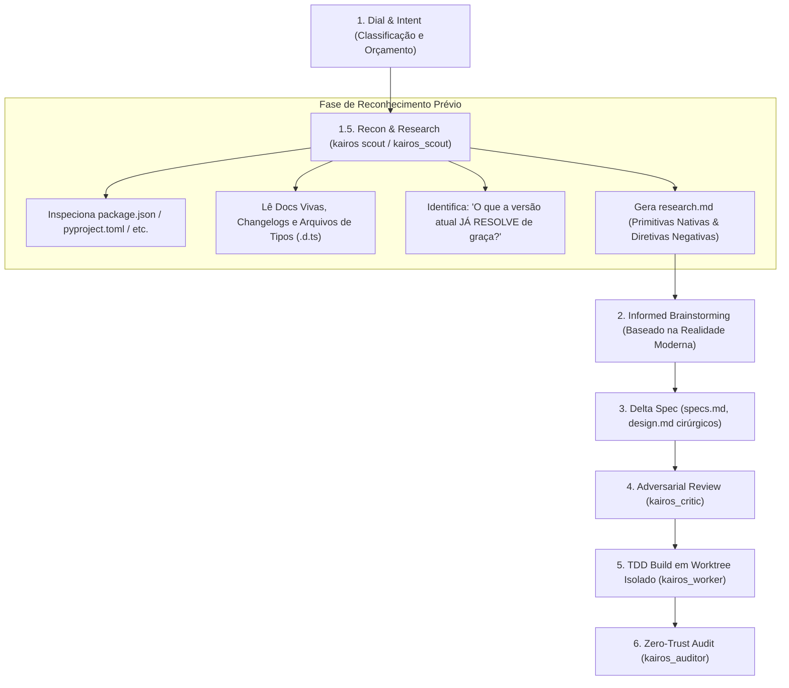

# 🧠 Research-First Brainstorming: Nunca Faça Brainstorming sobre Premissas Obsoletas

> **Como o KAIROS inverte a ordem tradicional da engenharia agêntica para evitar a reinvenção da roda e o sofrimento com workarounds desnecessários.**  
> *Estudo de Caso Real: Colyseus no Omnistage Engine.*

---

## 1. O Problema da Ordem Invertida (A Falha dos Frameworks Tradicionais)

Na maioria dos harnesses e metodologias agênticas (como Superpowers ou Vibe Coding puro), o fluxo segue a seguinte sequência linear:

```text
[Demanda do Usuário] ➔ [Brainstorming / Arquitetura] ➔ [Especificação] ➔ [Implementação]
```

### Por que essa ordem é fatal?
Quando o modelo de linguagem entra na fase de **Brainstorming** antes de pesquisar o estado da arte e a versão real instalada no projeto:
1. **Ele faz brainstorming baseado no passado:** Se o treinamento do LLM tem cutoff em 2023/2024, ele assume que o framework ainda tem as limitações e bugs daquela época.
2. **Ele projeta soluções complexas para problemas que já não existem:** O modelo gasta milhares de tokens e horas de trabalho humano projetando arquiteturas customizadas, pontes de comunicação e máquinas de estado caseiras.
3. **A dor do desenvolvedor:** O projeto é inundado com 800 linhas de código frágil, suscetível a race conditions e bugs de rede, quando uma única função nativa da versão moderna resolveria o problema.

---

## 2. O Estudo de Caso Real: Colyseus no Omnistage Engine

O caso do **Omnistage Engine** com **Colyseus** é o exemplo arquetípico dessa dor:

### O Cenário
O usuário precisava de gerenciamento robusto de sessões multijogador em tempo real, reconexão transparente de clientes em caso de instabilidade de rede e sincronização otimizada de estado.

### O Que a IA Fez sem o Research Prévio (A Abordagem Obsoleta)
Apoiando-se no viés estatístico de versões antigas do Colyseus (0.12 ou 0.14), a IA propôs:
* Projetar um sistema customizado de buffer e reconciliação delta para o estado da sala.
* Criar uma camada complexa de tokens e heartbeat com Redis para permitir que um usuário desconectado recuperasse seu assento.
* Escrever dezenas de utilitários manuais de serialização para evitar overhead de rede.

**O Resultado:** Sofrimento extremo, dias de debugging de concorrência no motor, vazamento de memória e frustração.

### A Realidade da Versão Moderna (Colyseus 0.15/0.16 & Schema v2)
Se a pesquisa tivesse ocorrido **antes** do brainstorming, a IA teria descoberto que o Colyseus moderno já resolveu absolutamente tudo isso de fábrica:
1. **Reconexão Automática e Nativa:**
   ```typescript
   // Resolvido em 1 linha de código nativo!
   async onLeave(client: Client, consented: boolean) {
     if (!consented) {
       await this.allowReconnection(client, 60); // O Colyseus segura o assento nativamente
     }
   }
   ```
2. **Schema v2 com Delta Encoding Binário:**
   O `@colyseus/schema` v2 gerencia mutações parciais automaticamente via buffers binários e suporta anotações como `@filter()` para enviar dados apenas a clientes autorizados. Nenhuma linha de serialização manual é necessária.
3. **Matchmaking e Presence Nativos:**
   O `matchMaker.reserveSeatFor()` e a camada de presença distribuída desacoplada cuidam de roteamento de salas sem necessidade de hacks no servidor.

> **Lição KAIROS:** Se o agente tivesse feito **Research antes do Brainstorming**, 90% daquele código nunca teria sido escrito!

---

## 3. O Fluxo KAIROS Invertido: Research-First Architecture

O KAIROS inverte o ciclo de vida. O reconhecimento técnico torna-se a **Etapa 1.5 obrigatória**, antes de qualquer discussão de design ou especificação:



---

## 4. O Princípio da Superfície Mínima (Rule of Minimal Surface Area)

O KAIROS impõe uma diretiva de engenharia:
$$\text{Qualidade do Código} \propto \frac{1}{\text{Linhas de Código Customizado Escritas}}$$

Antes de propor qualquer componente em uma sessão de brainstorming, o agente deve responder a 3 perguntas de validação:
1. **O framework instalado já possui essa primitiva nativa?**  
   *(Ex.: Colyseus tem `allowReconnection`? Next.js tem Server Actions? Pydantic tem `model_dump`?)*
2. **Existe um helper ou convenção moderna recomendada pela documentação oficial?**  
   *(Ex.: Não reinventar middlewares manuais de CORS se a biblioteca já tem plugin oficial).*
3. **Quais são as armadilhas legadas que devemos proibir explicitamente?**  
   *(Ex.: Registrar no `research.md` as APIs que o worker está terminantemente proibido de tentar usar).*

---

## 5. Como Operar o Research-First no KAIROS

### No Terminal:
Antes de abrir qualquer discussão de arquitetura ou criar especificações:
```bash
# 1. Executar o scanner de stack e dependências
python3 scripts/kairos_cli.py scout

# 2. Inicializar o Delta Spec e acoplar o brief de pesquisa
python3 scripts/kairos_cli.py spec nova-feature-multijogador
python3 scripts/kairos_cli.py scout --save-spec
```

### Na Sessão do Agente:
Ao iniciar uma demanda no **Modo Gamma** ou **Modo Beta complexo**:
1. O agente invoca o `kairos_scout` para investigar changelogs e tipos locais da biblioteca alvo.
2. O `kairos_scout` preenche a seção:
   ```markdown
   ## Pre-Brainstorming Stack Discovery (Native Primitives First)
   - O Colyseus 0.15 já inclui `allowReconnection()`. NÃO construir reconexão customizada com Redis.
   - O `@colyseus/schema` v2 gerencia sincronização delta. NÃO implementar serializadores manuais.
   ```
3. Apenas com esse documento em mãos, o time ou o agente inicia o **Brainstorming**, escolhendo a arquitetura com o menor número possível de linhas de código.

---

## 6. Conclusão

Fazer brainstorming sem pesquisa técnica prévia é receita para frustração e código legado recém-escrito.  
No KAIROS, **a pesquisa técnica precede a imaginação arquitetural**, garantindo que o agente sempre construa sobre os ombros das versões mais recentes e eficientes do ecossistema.
