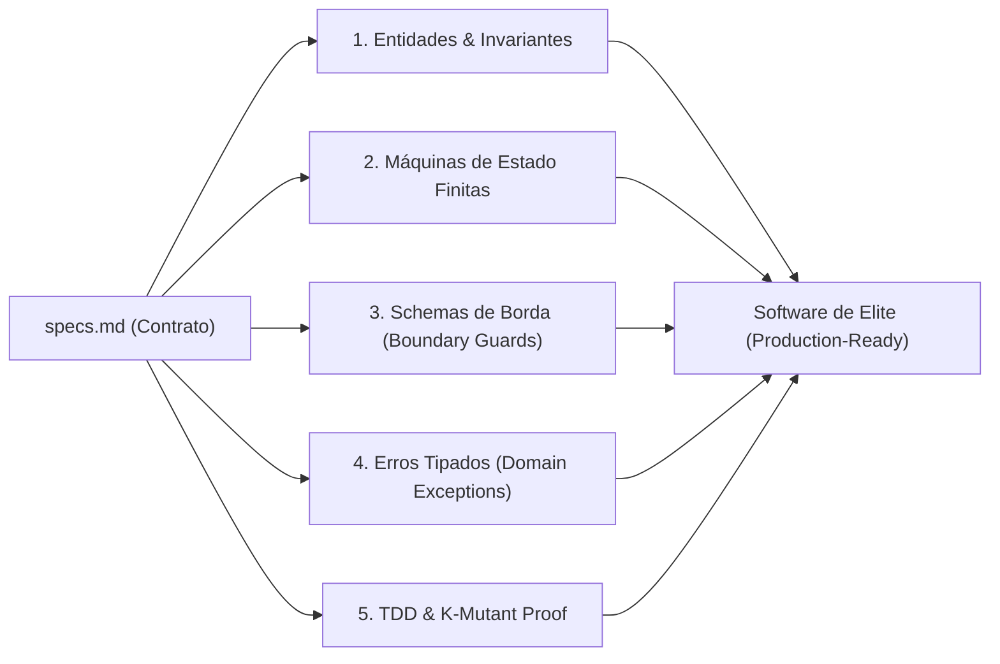

# KAIROS Spec-to-Code Engineering Standard: Qualidade Máxima & Aproveitamento da Inteligência

> **"Economizar tokens é uma virtude de custo; entregar código de engenharia de elite é a razão de existir do KAIROS."**

O KAIROS não foi criado apenas para "gastar pouco", mas para direcionar a capacidade de raciocínio profundo (*Deep Reasoning*) dos modelos de fronteira para aquilo que realmente importa: **modelagem de domínio, garantia de invariantes, tratamento estrito de bordas e código limpo à prova de regressão**.

---

## 1. O Compilador Mental: Como Specs Viram Funcionalidades de Elite

No desenvolvimento tradicional com IA ("Vibe Coding"), o modelo recebe uma ideia vaga e cospe um arquivo gigante com lógica de negócio misturada com banco de dados e rotas HTTP (código espaguete).

No KAIROS, a especificação em `.kairos/changes/<id>/specs.md` funciona como um **contrato formal executável**. O modelo é instruído a transformar cada cláusula em código através de **5 Pilares de Qualidade**:



---

## 2. Os 5 Pilares de Qualidade do KAIROS

### Pilar 1: Invariantes de Domínio (Chega de Modelos Anêmicos)
* **O Erro Comum:** Criar classes ou interfaces onde todos os campos são opcionais ou mutáveis (`any`, `dict`, objetos sem validação), permitindo que estados inválidos existam na memória.
* **O Padrão KAIROS:**
  * Toda regra de negócio declarada em `Invariants` na spec deve ser garantida no construtor da entidade.
  * Construtores privados ou factories com validação imediata.

```typescript
// ❌ Código Vibe Coding (Frágil, permite saldo negativo ou ID inválido):
interface Account {
  id?: string;
  balance?: number;
}

// ✅ Padrão de Engenharia KAIROS (Blindado por invariantes da spec):
export class BankAccount {
  private constructor(
    public readonly id: AccountId,
    private _balance: Money
  ) {}

  public static create(id: AccountId, initialDeposit: Money): BankAccount {
    if (initialDeposit.isNegative()) {
      throw new InvalidInitialDepositException("Saldo inicial não pode ser negativo");
    }
    return new BankAccount(id, initialDeposit);
  }

  public withdraw(amount: Money): void {
    if (this._balance.isLessThan(amount)) {
      throw new InsufficientFundsException(this.id, amount, this._balance);
    }
    this._balance = this._balance.subtract(amount);
  }
}
```

---

### Pilar 2: Máquinas de Estado Finitas vs. "Sopa de Booleans"
* **O Erro Comum:** O modelo cria múltiplos campos booleanos (`isLoading`, `isFailed`, `isProcessing`, `isDone`), gerando combinações impossíveis (ex: `isLoading === true` E `isDone === true`).
* **O Padrão KAIROS:** Modelar o ciclo de vida da funcionalidade como uma **Máquina de Estados Finita (FSM)** explícita com tipos discriminados (*Discriminated Unions*).

```typescript
// ✅ Padrão KAIROS: Estados Impossíveis se tornam Incompiláveis:
export type ProtocolState =
  | { status: 'DRAFT'; draftContent: string }
  | { status: 'PENDING_APPROVAL'; submittedAt: Date; reviewerId?: string }
  | { status: 'APPROVED'; approvedAt: Date; approvalHash: string }
  | { status: 'REJECTED'; reason: string; rejectedAt: Date };
```

---

### Pilar 3: Validação Estrita nas Bordas do Sistema (*Boundary Guards*)
* **O Padrão KAIROS:** Nenhuma entrada externa (JSON de requisição, resposta de API externa, variável de ambiente) entra no núcleo da aplicação sem ser validada por um schema estrito (Zod no TypeScript, Pydantic no Python, class-validator no NestJS).

```python
# ✅ Padrão KAIROS (Python / Pydantic):
from pydantic import BaseModel, Field, field_validator

class CreateProtocolRequest(BaseModel):
    title: str = Field(..., min_length=5, max_length=150)
    department_id: int = Field(..., gt=0)
    documents: list[str] = Field(default_factory=list)

    @field_validator("title")
    @classmethod
    def sanitize_title(cls, v: str) -> str:
        clean = v.strip()
        if not clean:
            raise ValueError("Título não pode ser vazio ou espaços")
        return clean
```

---

### Pilar 4: Tratamento de Erros Tipados (Sem `try/catch` Vazios)
* **O Erro Comum:** Capturar exceções genéricas (`except: pass` ou `catch (e) {}`), engolindo falhas que corrompem dados.
* **O Padrão KAIROS:**
  1. Erros previsíveis de negócio são classes explícitas (`DomainException`).
  2. A camada de infraestrutura traduz erros de banco/rede para erros de domínio.
  3. A camada de API mapeia cada erro de domínio para o código HTTP exato (400, 404, 409, 422).

---

### Pilar 5: Testes de Força Comprovada (K-Mutant Verification)
* **O Padrão KAIROS:**
  * O código gerado não é considerado pronto apenas porque a suíte de testes passou.
  * O desenvolvedor ou o auditor executa `kairos mutate`: mutações sintéticas são injetadas (inversão de operadores lógicos, troca de sinais matemáticos).
  * Se a suíte de testes continuar verde enquanto o código está mutado, **os testes são rejeitados como tautológicos**.

---

## 3. O Aproveitamento da Inteligência do Modelo

O KAIROS maximiza a inteligência do LLM da seguinte forma:

1. **Desonera a Memória de Curto Prazo:** Como o agente opera com Delta Specs cirúrgicas e worktrees isoladas, sua janela de contexto permanece limpa (menos de 30% ocupada). Isso elimina a **degradação de atenção (*attention decay*)**, permitindo que o modelo raciocine com clareza máxima.
2. **Estimula o Raciocínio Adversarial:** Ao usar o `kairos_critic`, o modelo não atua como executor submisso, mas como um **Arquiteto Sênior Externo** pago para encontrar falhas de segurança e escalabilidade antes do código ser escrito.
3. **Foco no que Humanos Falham:** A IA é guiada para cobrir exaustivamente testes de borda (overflows numéricos, valores nulos, fuso-horários, concorrência assíncrona), onde a mente humana costuma deixar passar bugs.
