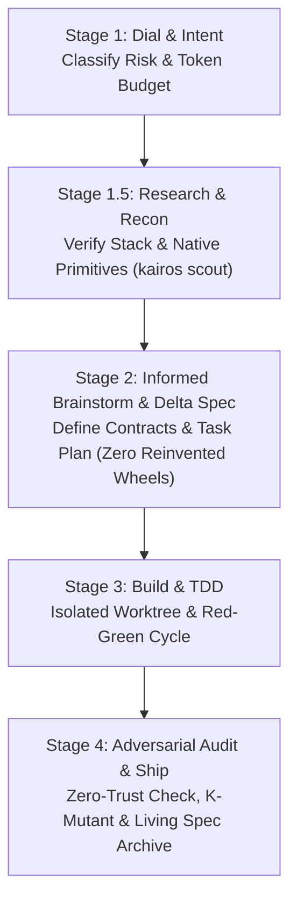

# KAIROS Master Orchestrator

The Master Orchestrator coordinates the end-to-end lifecycle of software development with adaptive token budgeting, mutation verification, and zero-trust quality gates.

## Invocation

```text
/kairos <task description>
/kairos:start <task description>
```

## The 5-Stage Orchestrated Flow (Research-First Architecture)



### Stage 1: The Elastic Dial (Risk & Mode Selection)
1. Run `python3 scripts/kairos_cli.py dial "<task description>"`.
   - **Mode Alpha (Lite / UI):** Typos, styles, small visual adjustments (<30 LOC).
   - **Mode Beta (Standard):** New endpoints, isolated features, bugfixes.
   - **Mode Gamma (Critical):** Core architecture, auth, database, multiplayer/financial logic.
2. Output telemetry header: `python3 scripts/kairos_cli.py status --header-only`.

### Stage 1.5: Pre-Brainstorming Recon & Research (The Anti-Reinvention Gate)
* **The Iron Law:** Never brainstorm architectural solutions or select stacks based on training memory assumptions.
* **In Mode Alpha:** Skipped (0 tokens).
* **In Mode Beta:** Run `python3 scripts/kairos_cli.py scout` to inspect local manifests and detect cutoff risks.
* **In Mode Gamma:** Mandatory invocation of `kairos_scout` to inspect live changelogs and type definitions. Identify what modern releases (e.g. Colyseus 0.15+, Next 15, Pydantic v2) already solve natively out-of-the-box before brainstorming custom logic.

### Stage 2: Informed Brainstorming & Spec Drafting
* **In Mode Alpha:** State the 3-point intent directly in chat (`Goal`, `Target File`, `Visual Verification`). Do NOT create files in `.kairos/changes/`.
* **In Mode Beta / Gamma:**
  1. Brainstorm with `research.md` in context: choose the *minimal surface area* by leveraging framework native primitives rather than building custom workarounds.
  2. Run `python3 scripts/kairos_cli.py spec <name>`. Fill `proposal.md`, `specs.md`, `design.md`, and `tasks.md`.
  3. In Mode Gamma: invoke `kairos_critic` (zero conversation context) for adversarial spec review.

### Stage 3: Surgical Execution (Build)
* **In Mode Alpha:** Apply the edit directly to the target file.
* **In Mode Beta / Gamma:**
  1. Create an isolated worktree via `python3 scripts/kairos_cli.py worktree create <name>`.
  2. For each task in `tasks.md`, follow the Iron Law of TDD:
     - Write the test first (Red).
     - Run the test and confirm it fails.
     - Implement the minimal production code (Green).
     - Refactor cleanly.
  3. If broken code accumulates, run `python3 scripts/kairos_cli.py rollback` to reset safely.

### Stage 4: Adversarial Audit & Ship
1. Run `python3 scripts/kairos_cli.py audit` on the git diff.
2. In Mode Beta/Gamma, run `python3 scripts/kairos_cli.py mutate <target> --test "<cmd>"` to verify test strength.
3. Check Mission Control: `python3 scripts/kairos_cli.py status --dashboard`.
4. If approved (READY):
   - In Mode Beta/Gamma: Run `python3 scripts/kairos_cli.py archive` to update living specs in `.kairos/specs/`.
   - Remove the temporary worktree via `python3 scripts/kairos_cli.py worktree remove`.
   - Report final outcome with evidence table.
